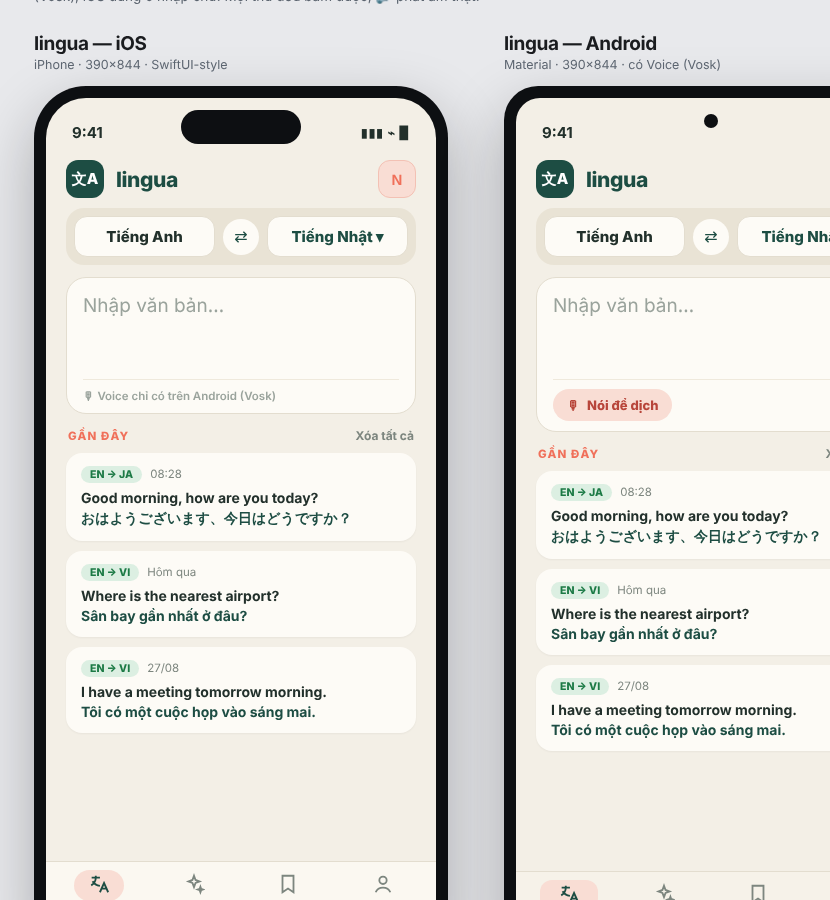
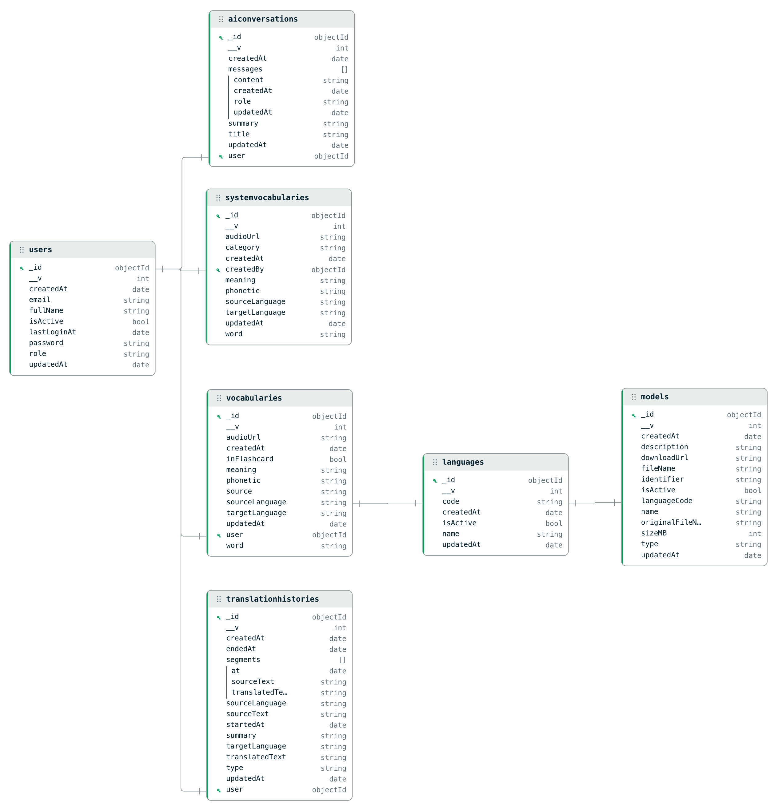

# Lingua: AI Translation & Language Learning App

> An offline-first mobile app that translates and teaches languages on-device, with an AI assistant, a Node.js API and an admin console, built around a carefully modelled MongoDB database.

   

| | |
|---|---|
| **Type** | Team project, Advanced Database Systems course (Master's program) |
| **Domain** | Mobile app, REST API, admin web, NoSQL data modelling |
| **Highlights** | On-device ML translation and speech, offline sync queue, `$jsonSchema` validation, query-driven indexes, transactions |

**Contents:** [Overview](#-overview) · [Key Features](#-key-features) · [Screenshots](#-screenshots) · [Tech Stack](#-tech-stack) · [Architecture](#-architecture) · [Project Structure](#-project-structure) · [Getting Started](#-getting-started) · [Configuration](#-configuration) · [Notes & Roadmap](#-notes--roadmap)

## 📖 Overview

Lingua translates text and speech **on the device** (no network needed after a one-time model download), saves words for flashcard practice, and offers a Gemini-powered AI assistant. Administrators manage users, languages, offline model packs and the system vocabulary from a web console. The app also serves as a vehicle to study **NoSQL document modelling** on MongoDB.

## ✨ Key Features

- **On-device translation** (Google ML Kit), **speech-to-text** (Vosk, Android) and **text-to-speech** (system engine)
- **Offline-first with guest mode**: history and saved words are stored locally, queued, and synced when the backend is reachable
- **Vocabulary and flashcards**: personal word list, curated system word bank, pronunciation audio
- **AI assistant**: chat and conversation summaries through Gemini, proxied by the backend so the key stays server-side
- **Admin console**: users, languages, model catalog with file upload, system vocabulary, statistics, Gemini key management
- **Database engineering**: schema validation, compound indexes, transactions and bounded embedded arrays

## 📸 Screenshots

| Translate screen: iOS and Android prototype |
|---|
|  |

Interactive UI prototypes (single-file HTML, no build step) are in [`docs/prototype/`](docs/prototype/); open `prototype_v2.html` in a browser. The database diagram is in [Architecture](#-architecture).

## 🛠 Tech Stack

| Component | Stack |
|---|---|
| [`mobile/`](mobile) | Flutter 3 (Android, iOS), Provider, ML Kit Translation, Vosk, flutter_tts |
| [`backend/`](backend) | Node.js, Express, Mongoose, JWT, Gemini API |
| [`admin-web/`](admin-web) | Node.js, Express, EJS (server-rendered), express-session |
| Database | MongoDB 7, database `language_app`, 7 collections |

## 🏗 Architecture

```
Flutter app ──┐
              ├──▶ REST API (backend :5000) ──▶ MongoDB
Admin web  ───┘         │
 (:4000)                └──▶ Gemini API (chat, summaries)
```

### Database design



*Generated with MongoDB Compass from the live database. Solid edges are `ObjectId` references; `languages` is referenced softly by code (`"en"`, `"vi"`, …).*

| Collection | Purpose | Key design decision |
|---|---|---|
| `users` | Accounts (user/admin) | bcrypt-hashed password, `select: false` |
| `translationhistories` | Translation history | **Polymorphic** by `type` (`text`, `speech`, `ai_chat`, `conversation`); voice sessions embed `segments[]` |
| `vocabularies` | Per-user saved words | Unique compound index `{user, word, targetLanguage}` |
| `systemvocabularies` | Admin-curated word bank | `createdBy` → `users` |
| `aiconversations` | Gemini chat sessions | `messages[]` embedded: one read returns the whole conversation |
| `languages` | Supported languages | Soft-referenced **by `code`**, not ObjectId |
| `models` | Vosk / ML Kit model catalog | Unique `{type, languageCode, identifier}` |

1. **Embed vs reference.** Messages and voice segments are embedded because they are always read with their parent. Vocabulary and history are separate collections because they need pagination and their own indexes. Embedded arrays are bounded (app cap 200, DB validator cap 400) to stay far from the 16 MB document limit.
2. **Soft references by language code.** Documents stay self-contained. Integrity is enforced in the API: deleting a referenced language returns HTTP 409; soft-delete (`isActive: false`) is used instead.
3. **No `ON DELETE CASCADE`.** Deleting a user cascades in application code, inside a multi-document **transaction** on a replica set (sequential fallback on standalone; the response reports `atomic`).
4. **Two-layer validation.** Mongoose in the app, plus `$jsonSchema` validators on all 7 collections, including `oneOf` on `type` for polymorphic history.
5. **Query-driven indexes.** Compound `{user, createdAt}`-style indexes; `explain()` shows the "recents" query examining 20 of 2,563 documents via `IXSCAN` with no in-memory sort.

### Offline-first mobile app

| Feature | Guest | Signed in, backend down |
|---|---|---|
| Text translation (ML Kit, pack downloaded once) | yes | yes |
| Speech to text (Vosk, Android) | yes | yes |
| Text to speech | yes | yes |
| History and saved words | local only | queued for sync |
| System word bank | no | cached copy |
| AI chat / summaries | no | no |

In `mobile/lib/core/`: `session.dart` (guest/account identity), `api_client.dart` (timeouts, circuit breaker), `local_store.dart` (lock-protected storage) and `sync_queue.dart` (ordered, idempotent replay on start, login and pull-to-refresh). Model resolution: installed on device → backend (cached) → built-in default.

## 📁 Project Structure

```
ai-iot-translation-app/
├── mobile/       # Flutter client
├── backend/      # REST API, seed scripts, DB validators
├── admin-web/    # Admin dashboard
└── docs/         # DB diagram, UI prototypes, screenshots, engineering notes
```

## 🚀 Getting Started

### Prerequisites

Node.js 18+, MongoDB 7 (Docker is easiest), Flutter SDK 3.3+.

### Installation and run

**1. MongoDB**

```bash
docker run -d --name lingua-mongo -p 27017:27017 mongo:7
```

**2. Backend** (port 5000)

```bash
cd backend
cp .env.example .env        # set JWT_SECRET; GEMINI_API_KEY is optional
npm install
npm run seed:admin          # admin@example.com / Admin@123
npm run seed:data           # sample data + user1@example.com / User@123
npm run db:sync             # attach $jsonSchema validators, sync indexes
npm run seed:rich           # optional: 15 learners, ~2.5k histories
npm run dev
```

**3. Admin web** (port 4000)

```bash
cd admin-web
cp .env.example .env
npm install
npm start                   # http://localhost:4000
```

**4. Mobile**

```bash
cd mobile
flutter pub get
flutter run
```

Demo accounts (local seed only): `admin@example.com` / `Admin@123` (admin), `user1@example.com` / `User@123` (user), `learner1..15@example.com` / `User@123` (after `seed:rich`).

## ⚙️ Configuration

| Setting | Where | Default | Purpose |
|---|---|---|---|
| `MONGO_URI`, `JWT_SECRET` | `backend/.env` | local MongoDB | Database and token signing |
| `GEMINI_API_KEY` | `backend/.env` or admin "Settings" page | empty | Enables the AI tab (a friendly error shows without it) |
| `BACKEND_API_URL`, `SESSION_SECRET` | `admin-web/.env` | `http://localhost:5000/api` | Admin web to API link |
| `baseUrl` | `mobile/lib/core/constants.dart` | Android `10.0.2.2:5000`, iOS `localhost:5000` | Use your LAN IP on a physical device |

## 📝 Notes & Roadmap

- Further reading: [Backend API reference](backend/README.md) · [Admin console](admin-web/README.md) · [Mobile app](mobile/README.md) · [Engineering notes](docs/engineering-notes.md)
- Vosk speech recognition is Android-only; iOS uses typed input.
- Possible next steps: OpenAPI/Postman collection, automated API tests, dark mode, charts for registration trends in the admin dashboard.
